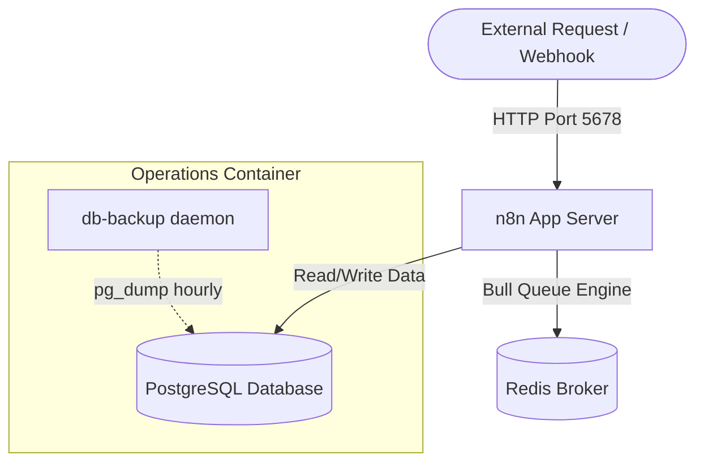

# Production n8n Workflows & GitOps Infrastructure

This repository is a production-ready, GitOps-driven boilerplate for managing self-hosted [n8n](https://n8n.io) integrations and workflows. It demonstrates industry best practices for continuous integration/deployment (CI/CD), security isolation, docker-based scaling (queue mode), and custom workflow validation.

---

## 🏗️ System Architecture

The following diagram illustrates the deployment topology configured in `docker-compose.yml`:



---

## 📁 Directory Structure

```text
├── .github/
│   └── workflows/
│       ├── lint-workflows.yml     # CI: Validates JSON structure, naming conventions, & checks secrets
│       └── deploy-workflows.yml   # CD: Deploys workflows to n8n instance via n8n REST API
├── scripts/
│   └── lint_workflows.py          # Custom Python validation script for workflow linting
├── workflows/
│   ├── global_error_handler.json  # Reusable sub-workflow for logging and Slack alerts
│   ├── lead_generation_crm_sync.json # Webhook lead processing & HubSpot CRM integration
│   ├── system_health_check_alerting.json # Automated Cron health checks on APIs and Databases
│   └── automated_invoice_pdf_generator.json # Invoice generation, AWS S3 upload, & email SMTP routing
├── .env.example                   # Environment configuration template
├── docker-compose.yml             # Local production-ready multi-container n8n environment
├── CONTRIBUTING.md                # Developer setup and contribution guidelines
└── LICENSE                        # MIT License
```

---

## 🚀 Getting Started (Local Setup)

### Prerequisites
- Docker & Docker Compose (v2.x or higher)
- Git

### Installation Steps

1. **Clone the Repository:**
   ```bash
   git clone https://github.com/MelvinjoseC/N8N-workflow.git
   cd N8N-workflow
   ```

2. **Configure Environment Variables:**
   Copy the template and fill in your keys:
   ```bash
   cp .env.example .env
   ```
   *Note: Make sure to change values for `N8N_ENCRYPTION_KEY`, database credentials, and API tokens.*

3. **Start the Stack:**
   Initialize all services in detached mode:
   ```bash
   docker compose up -d
   ```
   This will spin up:
   * **n8n app server** listening on `http://localhost:5678`
   * **PostgreSQL 15 database** for workflow storage and execution logs
   * **Redis 7 database** for scale/queue management
   * **Database backup daemon** that automatically takes snapshots and purges backups older than 7 days

4. **Verify Container Health:**
   ```bash
   docker compose ps
   ```

---

## ⚙️ Core Workflows Explained

All workflows in the `workflows/` directory are configured with centralized error routing pointing to the **Global Error Handler** workflow.

### 1. Global Error Handler (`global_error_handler.json`)
* **Trigger:** Error Trigger node.
* **Functionality:** Captures crash/fail execution metadata, formats a clean Slack block message with URLs, and pushes the event to Slack while logging to output.
* **Significance:** Standardizes incident alerts across all integration pipelines.

### 2. Lead Generation & CRM Sync (`lead_generation_crm_sync.json`)
* **Trigger:** Webhook endpoint.
* **Functionality:** Validates and normalizes user input via JS, queries HubSpot by email, forks logic to create or update contact details, and registers a sales notification in Slack.

### 3. System Health Check & Alerting (`system_health_check_alerting.json`)
* **Trigger:** Cron Node (every 15 minutes).
* **Functionality:** Validates external HTTP API connectivity and tests the internal PostgreSQL database latency via `SELECT 1;`. Passes metadata to the evaluator before pushing status reports.

### 4. Automated Invoice PDF Generator (`automated_invoice_pdf_generator.json`)
* **Trigger:** Order confirmation Webhook.
* **Functionality:** Extracts billing records, constructs a responsive HTML invoice template dynamically, sends it to Gotenberg API for PDF generation, uploads the document to Amazon S3, and emails the PDF as an attachment using SMTP.

---

## 🛠️ Tooling & Validation Script

We use a custom, zero-dependency Python script, `scripts/lint_workflows.py`, to parse and lint all workflow exports before they reach staging or production environments.

### Linting Rules Checked:
1. **Secret Scanning:** Scans for parameters matching sensitive keywords (e.g., `key`, `secret`, `password`, `token`) and flags values that look like plain text credentials rather than secure environment references (`{{ $env.VAR }}`).
2. **Error Handling Presence:** Ensures workflows are registered with a designated `errorWorkflow` to prevent silent failures.
3. **Naming Conflicts:** Ensures all nodes inside a workflow have unique, descriptive names for proper reference mapping.

### How to Run Locally:
```bash
python scripts/lint_workflows.py workflows/
```

---

## 🤖 CI/CD Pipeling GitOps Flow

This repository leverages GitHub Actions to establish a robust deployment pipeline:

### Pull Request / Merge CI (Lint Check)
Every branch push or Pull Request triggers `.github/workflows/lint-workflows.yml` which executes the Python validator script. Any syntax issue or suspected credential failure blocks the build.

### Production CD (Auto-sync)
Merging into `main` or `master` triggers `.github/workflows/deploy-workflows.yml`. It compares local file states against the target n8n instance API using python orchestration, performing a `PUT` to update existing workflows, or a `POST` to register new ones automatically.
