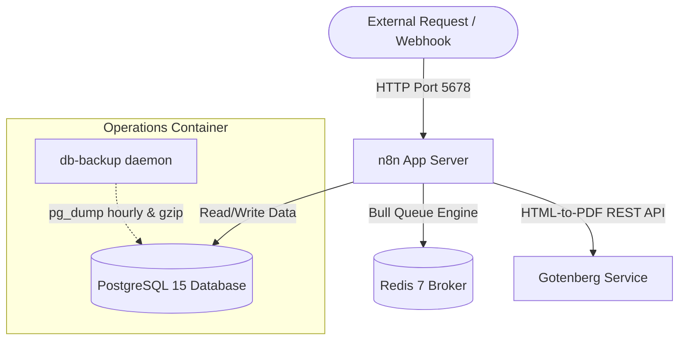

# Production n8n Workflows & GitOps Infrastructure

This repository is a production-grade, GitOps-driven boilerplate for managing self-hosted [n8n](https://n8n.io) integrations and workflows. It demonstrates industry best practices for continuous integration/deployment (CI/CD), security isolation, docker-based scaling (queue mode), automated workflow validation, and disaster recovery.

---

## 🏗️ System Architecture

The following diagram illustrates the deployment topology configured in `docker-compose.yml`:



---

## 📁 Directory Structure

```text
├── .github/
│   ├── workflows/
│   │   ├── lint-workflows.yml          # CI: Validates JSON structure, secrets & node versions
│   │   ├── run-tests.yml               # CI: Matrix unit testing across Python 3.10, 3.11, 3.12
│   │   ├── deploy-workflows.yml        # CD: Idempotent deployment to n8n with backup & git tags
│   │   ├── docker-compose-validate.yml # CI: Validates Docker Compose syntax and env schemas
│   │   └── security-audit.yml          # CI: Bandit AST and pip vulnerability scanner
│   └── dependabot.yml                  # Automated weekly dependency updates
├── docs/
│   └── adr/
│       ├── 0001-gitops-workflow-sync-architecture.md # Architecture decision: GitOps workflow
│       └── 0002-scaling-n8n-with-redis-queue-mode.md # Architecture decision: Bull queue scaling
├── scripts/
│   ├── lint_workflows.py               # Custom workflow linter with color, JUnit/JSON reporting
│   ├── deploy_workflows.py             # Syncs local workflows to n8n API with dry-run and retries
│   ├── export_workflows.py             # Bidirectional sync: exports remote workflows to repo
│   ├── validate_env.py                 # Audits .env for insecure defaults and missing variables
│   └── restore_db.sh                   # Disaster recovery script for gzipped postgres dumps
├── tests/
│   ├── test_lint_workflows.py          # Unit test suite for workflow linter
│   ├── test_deploy_workflows.py        # Unit test suite for deployment script
│   ├── test_export_workflows.py        # Unit test suite for workflow exporter
│   └── test_validate_env.py            # Unit test suite for environment validator
├── workflows/
│   ├── global_error_handler.json       # Centralized incident handler for Slack alerting
│   ├── lead_generation_crm_sync.json   # Webhook lead qualification & HubSpot CRM routing
│   ├── system_health_check_alerting.json # Automated 15-min database & API status probes
│   ├── automated_invoice_pdf_generator.json # Gotenberg PDF generator & AWS S3/SMTP pipeline
│   ├── database_retention_cleanup.json # Daily automated execution log retention cleanup
│   └── uptime_latency_monitor.json     # Continuous 5-min uptime probe and latency alerting
├── .env.example                        # Hardened environment variable configuration template
├── .n8n-lint.json                      # Configurable rules engine for workflow linter
├── .pre-commit-config.yaml             # Pre-commit hook definitions for code quality
├── pyproject.toml                      # Standard Python project packaging and tool configuration
├── pytest.ini                          # Pytest test discovery and execution configuration
├── docker-compose.yml                  # Production multi-container stack (n8n, db, redis, gotenberg)
├── Makefile                            # Standardized developer CLI interface
├── CONTRIBUTING.md                     # Engineering contribution and workflow guidelines
├── SECURITY.md                         # Security policy and disclosure process
└── LICENSE                             # MIT License
```

---

## 🚀 Getting Started (Local Setup)

### Prerequisites
- Docker & Docker Compose (v2.x or higher)
- Python 3.10+
- Git

### Installation Steps

1. **Clone the Repository:**
   ```bash
   git clone https://github.com/MelvinjoseC/N8N-workflow.git
   cd N8N-workflow
   ```

2. **Configure Environment Variables:**
   ```bash
   cp .env.example .env
   ```
   *Audit your `.env` configuration against security defaults:*
   ```bash
   make audit-env
   ```

3. **Start the Stack:**
   ```bash
   docker compose up -d
   ```
   Services initialized:
   * **n8n app server** listening on `http://localhost:5678` with active healthcheck probe
   * **PostgreSQL 15 database** with automated volume persistence
   * **Redis 7 broker** for Bull Queue asynchronous task processing
   * **Gotenberg service** on `http://localhost:3000` for containerized HTML-to-PDF rendering
   * **Database backup daemon** rotating compressed snapshots every 24 hours with 7-day retention

4. **Verify Container Health:**
   ```bash
   docker compose ps
   ```

---

## ⚙️ Workflows Overview

All workflows designate the **Global Error Handler** (`global_error_handler.json`) for centralized failure notification.

| Workflow | Trigger | Description | Integrations |
| :--- | :--- | :--- | :--- |
| **Global Error Handler** | Error Trigger | Captures execution crashes, formats rich Slack blocks | Slack Webhook |
| **Lead Generation & CRM Sync** | Header-Auth Webhook | Validates lead payload, creates/updates contacts | HubSpot CRM, Slack |
| **System Health Check** | Cron (15m) | Probes backend endpoints and executes `SELECT 1;` | PostgreSQL, Slack |
| **Automated Invoice PDF** | Header-Auth Webhook | Renders HTML invoice, converts to PDF via Gotenberg | Gotenberg, AWS S3, SMTP |
| **Database Retention Cleanup** | Cron (Daily 02:00) | Prunes execution records older than 30 days | PostgreSQL, Slack |
| **Uptime & Latency Monitor** | Cron (5m) | Measures endpoint latency and alerts on degradation | HTTP API, Slack |

---

## 🛠️ Developer Tooling & CLI Commands

### Makefile Shortcuts
- **`make lint`**: Runs workflow linter with ANSI color output.
- **`make test`**: Executes complete Python test suite via `pytest`.
- **`make audit-env`**: Verifies `.env` against production rules.
- **`make export`**: Exports workflows from live n8n instance into `workflows/`.
- **`make up` / `make down`**: Controls dockerized stack lifecycle.
- **`make backup`**: Manually creates a compressed PostgreSQL backup.
- **`make clean`**: Removes pytest and Python temporary cache files.

### Workflow Linter (`scripts/lint_workflows.py`)
Configured via `.n8n-lint.json`:
- **Secret Scanning:** Flags suspected API tokens and passwords while allowing `{{ $env.VAR }}` expressions.
- **Error Routing:** Enforces designation of `errorWorkflow`.
- **Resilience:** Flags HTTP nodes missing explicit `timeout` settings.
- **Deprecations:** Checks node `typeVersion >= 1`.
- **Connection Integrity:** Verifies all graph links connect existing nodes.
- **Reporting:** Supports `--format text|json|junit` and `--output FILE` for CI dashboards.

### Deployment Script (`scripts/deploy_workflows.py`)
- **`--dry-run`**: Simulates deployment without modifying remote state.
- **`--backup-dir <dir>`**: Automatically downloads pre-deploy remote backups before overwriting.
- **Git Metadata Stamping:** Injects git commit hash and deploy timestamp into workflow tags/metadata.
- **Resilient Networking:** Retries on transient 502/503/504 errors with exponential backoff.

### Database Recovery (`scripts/restore_db.sh`)
```bash
./scripts/restore_db.sh /backups/n8n_db_backup_20261014.sql.gz
```
Verifies gzip archive integrity, closes active database connections, restores schemas, and validates table counts.
